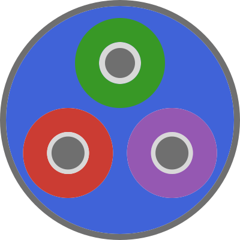

# LineCableModels.jl



[](https://electa-git.github.io/LineCableModels.jl/dev/)
[](https://github.com/Electa-Git/LineCableModels.jl/actions/workflows/CI.yml?query=branch%3Amain)
[](LICENSE)
[](https://codecov.io/gh/Electa-Git/LineCableModels.jl)

LineCableModels.jl computes electrical parameters for underground and overhead
power cables and supports uncertainty propagation through cable geometry and
material data.

## Features

- Solid, tubular, stranded, screened, and armored cable models.
- Frequency-dependent series impedance and shunt admittance calculations.
- Earth-return calculations, modal transformations, and ATPDraw/PSCAD data
  exchange.
- Material and cable libraries with JSON import and export.
- `Grid` and `Gridspace` for deterministic and uncertain designs.
- Ordinary, combinatorial, and conditional Monte Carlo execution through
  `compute`.
- Optional Makie plotting through Julia package extensions.

## Installation

After version 0.2.0 is accepted into the Julia General registry:

```julia-repl
pkg> add LineCableModels
```

Until registration is complete, install the release commit from GitHub:

```julia-repl
pkg> add https://github.com/Electa-Git/LineCableModels.jl
```

Core usage has no plotting dependency:

```julia
using LineCableModels
```

The physical model is built directly from materials, primitives, and cable
parts:

```julia
copper = Material(; kind=:conductor, rho=1.7241e-8)
xlpe = Material(; kind=:insulator, rho=1.97e14, eps_r=2.5)

origin = Stack(
    Group(:core, core(copper; r=10e-3, tag=:core_metal)),
    insulation(xlpe; t=8e-3),
)
design = build(CableDesign, "example", origin)

constants = CableConstants(design)
```

Scalar `build` calls return completed domain objects. An explicit `Grid` at a
construction call returns a `Gridspace` whose points invoke the same
scalar `build` method.

## Optional plotting

Load one Makie backend explicitly before calling `preview` or `plot`:

```julia
using LineCableModels
using CairoMakie

plot_pages = plot(line_parameters) # R, X, G, B matrix-dashboard pages
export_svg(plot_pages[1]; path = "series_resistance.svg")

self_impedance = plot(line_parameters, @observe Z[1, 1, :])
# `self_impedance` is one UIPlot with separate R and X axes.
```

`GLMakie` and `WGLMakie` are supported in the same way. Load the backend you want
for display and also `import CairoMakie` if SVG export is needed. The optional
`backend=:cairo`, `:gl`, or `:wgl` keyword selects a backend for one call. Observation requests determine
physical quantity and coordinate axes. `layout` only groups those facets into
figures. Singular recipes return a `UIPlot`. Calls that produce several figures
return a vector. Each handle exposes native Makie objects that remain
caller-owned. `figure_title` names the whole figure, `panel_titles` names its
logical axes, and `series_labels` names overlaid result containers in legends.
Matrix coordinates belong in semantic axis titles, never legend entries.
Legends accept outer docks or
`legend_position=:inside` with native `halign` and `valign`. `figurelegend!`,
`panellegend!`, `figuretitle!`, and `paneltitle!` can change those native blocks
after construction. The Export SVG control appears only when CairoMakie is loaded
before plot construction. It saves the current live state without switching
display backends. For GL interactivity with export, import both backends and
select `backend=:gl`. After loading CairoMakie later, `export_svg` also works on
existing plots. Recreate the plot to add its button.

## Result access

`CableConstants` stores R/L/C values per meter. `LineParameters`
stores its frequency domain and Z/Y per meter, in Ω/m and S/m:

```julia
Z(line_parameters) .* line_length(line_parameters)   # the whole line, in Ω
@observe line_parameters R[1, 1, :]       # complete frequency response
@observe line_parameters Z[1, 1, 2:5]     # selected frequency samples
@observe line_parameters (Z, abs)[1, 2, :]

label(R)                         # "Series resistance"
symbol(Z, angle)                 # "∠Z"
label(display_unit(R))           # "Ω/km"
```

Complete parameter traversals return `ParametricResult{T}`, including a space
with cardinality one. `Formulation`, `CableConstantsFormulation`, and
`ModalTransformationFormulation` accept explicit `Grid` fields. Combinatorial
calculation forms the Cartesian product of problem and formulation points and
retains both axes for `result(run, problem_index, formulation_index)` lookup.
Conditional Monte Carlo propagation returns
`MonteCarloResult{T}`. Use `statistics`, `samples`, `histograms`, and
`uncertain` to inspect stored calculation data. Load `Measurements` before
computation: MC stores marginal Measurements built from accepted sample means
and sample standard deviations, without joint output correlations. `uncertain`
and downstream transport reuse those stored values. Result order is
problem-index-fastest within formulation order. Parametric, linear-error, and
Monte Carlo results are ordinary finite collections: indexing and iteration
return stored core results, and Base
`first`, `last`, `only`, `collect`, `map`, and `zip` retain their standard
meanings.
Select the statistics to include in a marginal summary before converting it
to a table:

```julia
using DataFrames

summary = DataFrame(observables(
    monte_carlo_result,
    ((statistics, R, 1), (statistics, L, 1),
     (statistics, G, 1), (statistics, C, 1)),
))
```

After loading a Makie package, `Makie.hist`, `Makie.stairs`, `Makie.ecdfplot`,
`Makie.lines`, and `Makie.qqplot` display retained distribution information.

Studies keep supplemental computation output separate from their scientific products.
`details(result)` returns an empty `ComputationDetails` by default. Its payload is
available through `.data`. Pass `options=(retain_details=true,)` to the computation of a
`Combinatorial`, `LinearError`, or `MonteCarlo` study only when the core computation owner
has registered a `computation_details` method and those records are needed.
Monte Carlo draws again a draw whose build throws `OverlapError`, or whose build or
computation throws `DomainError`, and records nothing about it. `max_failures` such draws
in a row for one trial stop the study. Any other exception propagates. The resulting
statistics are conditional on a successful realization.

Physics and numerical-method choices belong to `Formulation`. Execution choices
are passed as a named tuple. Line parameters are always per meter. The whole
line's Z and Y are `Z(result) .* line_length(result)` and
`Y(result) .* line_length(result)`. Composite calculations select their operation explicitly, such as
`compute(ParametricProblem(space), Combinatorial(Formulation()))`.

Write results to an XLSX workbook with `report`:

```julia
using XLSX

artifact = report(
    XLSXReportDefinition(file_name="line_parameters.xlsx"),
    line_parameters,
)
artifact.output
```

XLSX is an optional dependency. Loading it activates the workbook writer. The
established `export_data(:xlsx, line_parameters; ...)` call delegates to the
same report and returns its output path. Relative paths and the default
`ZY_export.xlsx` resolve from the caller's current working directory.

See the [documentation](https://electa-git.github.io/LineCableModels.jl/), the
[cable data model](docs/src/data-model.md) and [examples](examples) for model
construction and parameter calculations.

## License and citation

LineCableModels.jl is distributed under the [BSD 3-Clause License](LICENSE).
[CITATION.cff](CITATION.cff) holds the citation metadata.

## Acknowledgments

This work is supported by the Etch Competence Hub of EnergyVille, financed by
the Flemish Government. The primary developer is Amauri Martins
([@amaurigmartins](https://github.com/amaurigmartins)).

<p align="left">
  <br>
  <br>
  <br>
</p>
