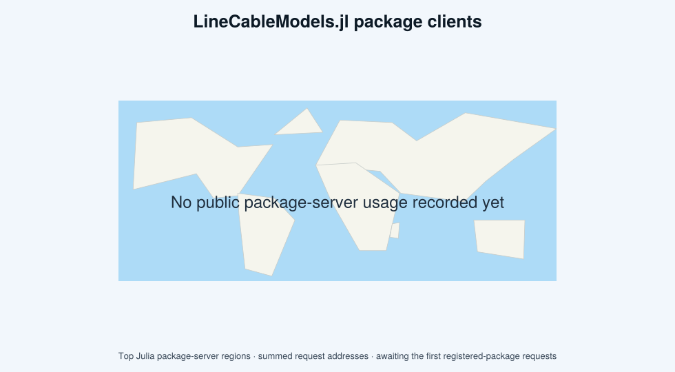

# LineCableModels.jl

[`LineCableModels.jl`](https://github.com/Electa-Git/LineCableModels.jl) is a Julia package
for computing the series impedances and shunt admittances per unit length of arbitrary
arrangements of underground and overhead power cables, with uncertainty propagation. A
computation is defined by a problem, which describes the cables, the earth, the operating
temperature and the frequencies of interest, and by a formulation, which selects the formulas for each physical contribution. The computation is carried out either by the coaxial analytical backend of the package or by the finite-element backend of the Gmsh extension.

## Documentation outline

- [Examples](examples.md): construction of four cable systems and computation of their line
  parameters.
- [Cable data model](data-model.md): materials, shapes, cable parts, designs and systems.
- [Line parameters](computing.md): problems, formulations, computations and results.
- [Finite element solver](fem.md): finite-element backend of the Gmsh extension and its options.
- [Uncertainty quantification](uncertainty.md): propagation of input uncertainties to the line parameters.
- [Theory](theory/contents.md): matrix formulation and formulas of each physical
  contribution.
- [API reference](reference.md): public names of the package.
- [Developers](developers/architecture.md): architecture, rules and conventions of the
  package.

## Main features

- **High-fidelity cable modeling.** Detailed representation of solid and stranded conductors,
  with round wires or rectangular strands laid on helices, semicon screens, insulation layers,
  sheaths, beddings, armors of round wires, jackets and fillers. Any number of cables can be
  placed in the same cross-section to form a cable system.
- **Equivalent tubular representation.** Each terminal of a cable is represented by an
  equivalent tubular conductor that preserves the DC resistance and the geometric mean radius
  of its regions, including the overlength of the round wires and rectangular strands laid on
  helices. The relative permeability of the insulation layers is corrected to account for the
  solenoid effect introduced by the helical path of the current in stranded conductors.
- **Internal impedances and admittances.** Internal impedances of multilayered coaxial cables
  based on the surface impedances of Schelkunoff [Schelkunoff1934](@cite) and on the general
  formulation of Ametani [Ametani1980](@cite), with conductor resistivities corrected to the
  operating temperature.
- **Earth-return impedances and admittances.** Earth-return impedances and potential
  coefficients of underground, overhead and mixed systems in homogeneous earth, computed by a
  unified formulation with a prescribed longitudinal wavenumber. The formulation includes the
  solutions of the underground case [5437464](@cite) and of the mixed overhead and
  underground case [MartinsBritto2024](@cite).
- **Phase-domain matrices.** Series impedance and shunt admittance matrices of polyphase
  systems with any number of conductors per phase, with bundling of bonded conductors, Kron
  elimination of grounded conductors and ideal transposition.
- **Finite element modeling.** Computation of the same problems on a mesh of the actual
  cross-section of the cables, by means of Gmsh and GetDP.
- **Uncertainty quantification.** Linear propagation of the uncertainties of materials,
  dimensions, positions, earth properties and temperature to the line parameters, by means of
  the [Measurements.jl](https://github.com/JuliaPhysics/Measurements.jl) package.

## Installation

Add the registered package to the Julia environment:

```julia-repl
pkg> add LineCableModels
```

Then, in your Julia code, import the package:

```julia
using LineCableModels
```

The extensions are loaded together with their packages, namely `using Measurements` for the
propagation of uncertainties and `using Gmsh` for the finite-element backend. The
finite-element backend uses the GetDP executable found on `PATH` when it is suitable, and
otherwise downloads GetDP 3.5.0 at its first use.

## Work in progress

Many further features have already been prototyped, tested and validated in the development
versions of the package, and are being progressively migrated to the stable release. These include:

- **Earth-return formulas.** Carson, Pollaczek, Wise, Saad, Wedepohl and Wilcox, Gary, Lucca and Xue.
- **Earth models.** Layered, frequency-dependent and equivalent homogeneous earth.
- **Cable components.** Lossy dielectrics, pipe-type cables and ducts, sector and Milliken
  conductors, tapes, rectangular armor wires and compacted conductors.
- **Line and cable constants.** DC and AC parameters of cable designs, modal decomposition and
  propagation along lines of finite length.
- **Parametric studies.** Parameter grids, Monte Carlo evaluation, observables, plotting
  through Makie, reports and tables.
- **Interfaces and libraries.** Export to ATPDraw, PSCAD and TRALIN, material and cable
  libraries, saving and loading.
- **Finite element tools.** Resuming of runs, mesh reuse, export to ONELAB, field maps and the
  GMRES solver.

## User statistics



The map shows the regions of the Julia package servers from which LineCableModels.jl is
downloaded. Each marker gives the sum of the request addresses recorded for the package in
that region, over the requests classified as user traffic in the public request logs of the
package servers. The map is generated at each build of the documentation.

## License

The source code is provided under the
[BSD 3-Clause License](https://github.com/Electa-Git/LineCableModels.jl/blob/main/LICENSE).

---

```@raw html
<p align="left">Documentation generated using <a target="_blank" href="https://github.com/JuliaDocs/Documenter.jl">Documenter.jl</a> and <a target="_blank" href="https://github.com/fredrikekre/Literate.jl">Literate.jl</a>.</p>
```
