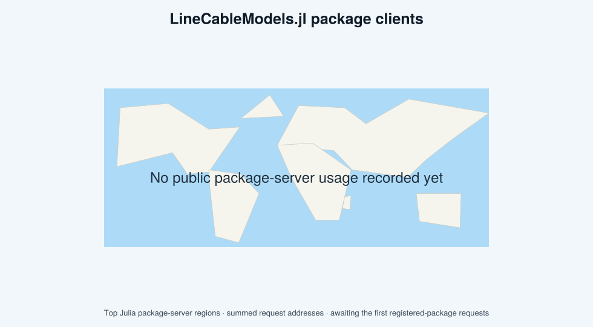

# LineCableModels.jl

[`LineCableModels.jl`](https://github.com/Electa-Git/LineCableModels.jl) is a Julia package
for computing the series impedances and shunt admittances per unit length of arbitrary
arrangements of underground and overhead power cables, with uncertainty propagation. A
computation is defined by a problem, which describes the cables, the earth, the operating
temperature and the frequencies of interest, and by a formulation, which selects the formulas for each physical contribution. The computation is carried out either by the coaxial analytical backend of the package or by the finite-element backend of the Gmsh extension.

## Documentation outline

- [Examples](examples.md): construction of four cable systems and computation of their line
  parameters.
- [Cable data model](data-model.md): materials, shapes, cable parts, designs and systems.
- [Line parameters](computing.md): problems, formulations, computations and results.
- [Finite element solver](fem.md): finite-element backend of the Gmsh extension and its options.
- [Uncertainty quantification](uncertainty.md): propagation of input uncertainties to the line parameters.
- [Theory](theory/contents.md): matrix formulation and formulas of each physical
  contribution.
- [API reference](reference.md): public names of the package.
- [Developers](developers/architecture.md): architecture, rules and conventions of the
  package.

## Main features

- **High-fidelity cable modeling.** Detailed representation of solid and stranded conductors,
  with round wires or rectangular strands laid on helices, semicon screens, insulation layers,
  sheaths, beddings, armors of round wires, jackets and fillers. Any number of cables can be
  placed in the same cross-section to form a cable system.
- **Equivalent tubular representation.** Each terminal of a cable is represented by an
  equivalent tubular conductor that preserves the DC resistance and the geometric mean radius
  of its regions, including the overlength of the round wires and rectangular strands laid on
  helices. The relative permeability of the insulation layers is corrected to account for the
  solenoid effect introduced by the helical path of the current in stranded conductors.
- **Internal impedances and admittances.** Internal impedances of multilayered coaxial cables
  by the general formulation of Ametani [Ametani1980](@cite). The surface impedances of the
  conductors follow Schelkunoff [Schelkunoff1934](@cite) or Wedepohl and Wilcox
  [Wedepohl1973](@cite), and their resistivities follow the operating temperature.
- **Lossy dielectrics.** The admittivity of an insulation or semicon layer includes its
  conduction and polarization loss when the formulation selects the lossy law.
- **Earth-return impedances and admittances.** Earth-return impedances and potential
  coefficients of underground, overhead and mixed systems, computed by a unified formulation
  with a prescribed longitudinal wavenumber. The formulation includes the solutions of the
  underground case [5437464](@cite) and of the mixed overhead and underground case
  [MartinsBritto2024](@cite).
- **Classical earth-return formulas.** Carson, Pollaczek, Wise, Gary, Wedepohl and Wilcox,
  Saad, Papadopoulos, Xue, Lucca and Ametani, selected per domain of a pair of cables. The
  macro `@formulation` writes a selection per domain as a block.
- **Earth models.** Layered earth models, with nine soil laws for the frequency dependence of
  each layer and two models of an equivalent homogeneous earth
  [MartinsBritto2020, Xue2021](@cite).
- **Phase-domain matrices.** Series impedance and shunt admittance matrices of polyphase
  systems with any number of conductors per phase, with bundling of bonded conductors, Kron
  elimination of grounded conductors and ideal transposition.
- **Analytical and FEM solutions.** The same problem is solved by the analytical coaxial
  formulation of the package, which combines the closed-form internal impedances of the
  tubular conductors with the earth-return integrals, or by the finite-element backend, which
  solves the field equations on a mesh of the actual cross-section of the cables with Gmsh
  and GetDP. Both return the same result.
- **Uncertainty quantification.** Linear propagation of the uncertainties of materials,
  dimensions, positions, earth properties and temperature to the line parameters, by means of
  the [Measurements.jl](https://github.com/JuliaPhysics/Measurements.jl) package.

## Installation

Add the registered package to the Julia environment:

```julia-repl
pkg> add LineCableModels
```

Then, in your Julia code, import the package:

```julia
using LineCableModels
```

The extension modules are loaded with the packages they build on, as described below.

## Extension modules

LineCableModels.jl provides extension modules that load with the packages they build on and
add a backend or a number type to the same problems and results.

### Gmsh.jl

Finite-element capabilities are introduced with `using Gmsh, getdp_jll`, which loads the
finite-element extension. Gmsh.jl provides the Gmsh library that meshes the cross-section,
and getdp_jll provides the GetDP 3.5.0 executable that solves the field equations in complex
arithmetic. A build of your own is selected through getdp_jll's `getdp_path` preference,
and the same problem is computed by `compute(problem, FEM())`. The
[finite-element guide](fem.md) describes the options of the backend, its run directory and
its accuracy on the reference systems.

### Measurements.jl

Uncertainty quantification is introduced with `using Measurements`. Any input of the problem
can then be given as an uncertain value, such as `Circle(4.0e-3 ± 1.0e-5)`. The resulting `Z`
and `Y` have uncertain real and imaginary parts, which the extension propagates linearly
through every formula. The [uncertainty quantification guide](uncertainty.md) describes the propagation and the
tests that verify it.

## Work in progress

Many further features have already been prototyped, tested and validated in the development
versions of the package, and are being progressively migrated to the stable release. These include:

- **Cable components.** Pipe-type cables and ducts, sector and Milliken conductors, tapes,
  rectangular armor wires and compacted conductors.
- **Line and cable constants.** DC and AC parameters of cable designs, modal decomposition and
  propagation along lines of finite length.
- **Parametric studies.** Parameter grids, Monte Carlo evaluation, observables, plotting
  through Makie, reports and tables.
- **Interfaces and libraries.** Export to ATPDraw, PSCAD and TRALIN, material and cable
  libraries, saving and loading.
- **Finite element tools.** Resuming of runs, mesh reuse, export to ONELAB, field maps and the
  GMRES solver.

## User statistics



The map shows the regions of the Julia package servers from which LineCableModels.jl is
downloaded. Each marker gives the sum of the request addresses recorded for the package in
that region, over the requests classified as user traffic in the public request logs of the
package servers. The map is generated at each build of the documentation.

## License

The source code is provided under the
[BSD 3-Clause License](https://github.com/Electa-Git/LineCableModels.jl/blob/main/LICENSE).

---

```@raw html
<p align="left">Documentation generated using <a target="_blank" href="https://github.com/JuliaDocs/Documenter.jl">Documenter.jl</a> and <a target="_blank" href="https://github.com/fredrikekre/Literate.jl">Literate.jl</a>.</p>
```
