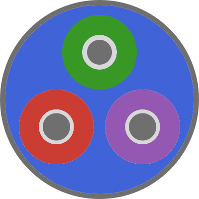

## A deliberately long title must wrap without asking the whole browser scene to shrink

::: {.lcm-layout-full-canvas}
::: {.lcm-slot .lcm-slot-panel}
[FOUNDATION GATE]{.lc-eyebrow}

This specimen is intentionally unfriendly. It combines dense prose, equations,
source code, a raster-independent image, browser controls, and a persistent
same-origin live route at several projector resolutions.

- Quarto and Pandoc own the source document.
- Reveal owns navigation, URL state, speaker view, fullscreen, and print hooks.
- LCM layouts own every presentation pixel.
- Live computation remains behind the playground boundary.

```{.julia .lcm-cell autorun="true" echo="false"}
using WGLMakie, Bonito
WGLMakie.activate!(resize_to = :parent);
```

::: {.notes}
This slide exists to expose overflow, scaling, and line-wrapping failures before
any scientific deck is migrated.
:::
:::
:::

## Balanced evidence

::: {.lcm-layout-balanced}
::: {.lcm-slot .lcm-slot-panel}
[Mathematical material]{.lcm-panel-title}

For a one-frequency result, the final decomposition remains

$$
R=\Re(Z),\qquad L=\frac{\cssId{impedance-imag}{\Im(Z)}}{\omega},\qquad
G=\Re(Y),\qquad C=\frac{\cssId{admittance-imag}{\Im(Y)}}{\omega}.
$$

::: {.lcm-math-note target="impedance-imag"}
**Imaginary part of impedance**

Dividing by angular frequency $\omega$ gives the inductance.
:::

::: {.lcm-math-note target="admittance-imag"}
**Imaginary part of admittance**

Dividing by angular frequency gives the capacitance. Click the term again,
click elsewhere, or press Escape to close this explanation.
:::

Click an outlined equation term to show its explanation.

```{.julia .lcm-cell autorun="true" echo="false"}
Z = 0.05 + 0.31im
```

```{.julia .lcm-cell}
ω = 2π * 50
R = real(Z)
L = imag(Z) / ω
(; R, L)
```
:::

::: {.lcm-slot .lcm-slot-panel}
[Image and browser controls]{.lcm-panel-title}

{fig-alt="LineCableModels logo"}

The range control must keep its arrow keys. Deck navigation must not steal
them while the control is focused.

<label for="specimen-range">Local visual value</label>
<input id="specimen-range" type="range" min="0" max="10" value="5">
:::
:::

## Persistent live viewport

::: {.lcm-layout-feature-sidebar}
::: {.lcm-slot .lcm-slot-panel}
[Engineering controls]{.lcm-panel-title}

```{.julia .lcm-cell autorun="true" echo="false"}
let f = exp10.(range(0, 6, 241)), h = 10.0, r = 0.0127, R_dc = 5.0e-5, μ₀ = 4π * 1e-7
    ρ = Bonito.Slider(round.(exp10.(range(1, 4, 31)); sigdigits = 2); value = 100.0)
    Z = map(ρ.value) do ρ_e
        ω = 2π .* f
        p = sqrt.(ρ_e ./ (im .* ω .* μ₀))
        R_dc .+ im .* ω .* μ₀ ./ 2π .* log.(2 .* (h .+ p) ./ r)
    end
    figure = Figure()
    axis_R = Axis(figure[1, 1]; xscale = log10, ylabel = "R [Ω/km]")
    axis_L = Axis(figure[2, 1]; xscale = log10, xlabel = "f [Hz]", ylabel = "L [mH/km]")
    lines!(axis_R, f, map(z -> 1e3 .* real.(z), Z))
    lines!(axis_L, f, map(z -> 1e6 .* imag.(z) ./ (2π .* f), Z))
    DOM.div(
        DOM.label("Earth resistivity ρ [Ω·m] ", ρ, " ", map(string, ρ.value)),
        DOM.div(figure; style = "min-width: 0; min-height: 0");
        style = "display: grid; grid-template-rows: auto minmax(0, 1fr); gap: 8px; height: 100%")
end
```
:::

::: {.lcm-slot .lcm-slot-panel}
[LIVE BOUNDARY]{.lc-eyebrow}

The frame is same-origin, mounted once, and never moved into the deck DOM.
Changing slides sends lifecycle messages; it does not reconstruct the Bonito
session.

In speaker receivers and print mode this region becomes a link to the
playground. No duplicate session is created.

The plot is the series impedance of one conductor 10 m above the earth, with
Deri's complex depth $p = \sqrt{\rho / (\mathrm{j} \omega \mu_0)}$:
$Z = R_{dc} + \mathrm{j} \omega \frac{\mu_0}{2 \pi} \ln \frac{2 (h + p)}{r}$.
:::
:::

## Top band plus two supporting regions

::: {.lcm-layout-top-split}
::: {.lcm-slot .lcm-slot-panel}
[One claim spans the complete width]{.lcm-panel-title}

The author chooses a named layout. The format—not hand-written slide CSS—owns
the geometry. Advance to reveal the left list, then the right list, in source order.
:::

::: {.lcm-slot .lcm-slot-panel}
[Authoring]{.lcm-panel-title}

::: {.incremental}
- Write ordinary Markdown.
  - Keep equations and notes in the source.
- Choose a reusable layout.
:::
:::

::: {.lcm-slot .lcm-slot-panel}
[Execution]{.lcm-panel-title}

::: {.incremental}
1. Open the presentation.
2. Navigate without a worker.
3. Follow the playground link for live work.
:::
:::
:::

## Four-panel dashboard

::: {.lcm-layout-dashboard-grid}
::: {.lcm-slot .lcm-slot-panel}
[R]{.lcm-panel-title}

Self resistance versus frequency.
:::
::: {.lcm-slot .lcm-slot-panel}
[L]{.lcm-panel-title}

Self inductance versus frequency.
:::
::: {.lcm-slot .lcm-slot-panel}
[C]{.lcm-panel-title}

Self capacitance versus frequency.
:::
::: {.lcm-slot .lcm-slot-panel}
[G]{.lcm-panel-title}

Self conductance versus frequency.
:::
:::

## Media and narrative

::: {.lcm-layout-media-story}
::: {.lcm-slot .lcm-slot-panel}
{fig-alt="LineCableModels logo"}
:::

::: {.lcm-slot .lcm-slot-panel}
[Presentation discipline]{.lcm-panel-title}

The visible artifact is intentionally quiet:

- no decorative gradients;
- no generic dashboard chrome;
- no layout animation;
- no hidden executable source;
- no screenshot machinery.

Press **L** to toggle the restrained presentation pointer.
:::
:::

## Full-canvas live boundary

::: {.lcm-layout-full-canvas}
::: {.lcm-slot .lcm-slot-panel}
[Persistent canvas coordinate probe]{.lcm-panel-title}

```{.julia .lcm-cell autorun="true" echo="false"}
App() do session
    canvas = DOM.canvas(;
        tabindex = "0", role = "application", var"aria-label" = "Presentation coordinate probe")
    status = DOM.output("Select a point inside the canvas")
    probe = DOM.div(canvas, status; class = "lc-presentation-probe", var"data-session-id" = session.id)
    Bonito.onload(session, probe, js"""
    (element) => {
        const canvas = element.querySelector('canvas');
        const status = element.querySelector('output');
        const context = canvas.getContext('2d');
        let lastPoint = null;

        const draw = () => {
            const box = canvas.getBoundingClientRect();
            const ratio = window.devicePixelRatio || 1;
            canvas.width = Math.max(1, Math.round(box.width * ratio));
            canvas.height = Math.max(1, Math.round(box.height * ratio));
            context.setTransform(ratio, 0, 0, ratio, 0, 0);
            context.clearRect(0, 0, box.width, box.height);
            const style = getComputedStyle(document.documentElement);
            context.strokeStyle = style.getPropertyValue('--lc-border-soft').trim();
            context.lineWidth = 1;
            for (let x = 24; x < box.width; x += 24) {
                context.beginPath(); context.moveTo(x, 0); context.lineTo(x, box.height); context.stroke();
            }
            for (let y = 24; y < box.height; y += 24) {
                context.beginPath(); context.moveTo(0, y); context.lineTo(box.width, y); context.stroke();
            }
            context.strokeStyle = style.getPropertyValue('--lc-focus').trim();
            context.strokeRect(0.5, 0.5, Math.max(0, box.width - 1), Math.max(0, box.height - 1));
            if (lastPoint) {
                context.fillStyle = style.getPropertyValue('--lc-link').trim();
                context.beginPath();
                context.arc(lastPoint.x, lastPoint.y, 6, 0, Math.PI * 2);
                context.fill();
            }
            element.dataset.backingWidth = String(canvas.width);
            element.dataset.backingHeight = String(canvas.height);
        };

        canvas.addEventListener('pointerdown', event => {
            const box = canvas.getBoundingClientRect();
            lastPoint = {x: event.clientX - box.left, y: event.clientY - box.top};
            element.dataset.lastX = lastPoint.x.toFixed(2);
            element.dataset.lastY = lastPoint.y.toFixed(2);
            status.textContent = `x = ${lastPoint.x.toFixed(1)} px · y = ${lastPoint.y.toFixed(1)} px`;
            draw();
        });
        const observer = new ResizeObserver(draw);
        observer.observe(canvas);
        window.addEventListener('lcm:viewport-settled', draw);
        window.addEventListener('lcm:theme-changed', draw);
        draw();
    }
    """)
    style = DOM.style("""
    .lc-presentation-probe {
      position: relative; display: grid; min-width: 0; min-height: 0; height: 100%; overflow: hidden;
      background: var(--lc-sunken-bg); border: 1px solid var(--lc-border);
    }
    .lc-presentation-probe canvas {
      display: block; width: 100%; height: 100%; min-height: 0; outline: 0; touch-action: none;
    }
    .lc-presentation-probe output {
      position: absolute; right: 0.65rem; bottom: 0.65rem; padding: 0.3rem 0.45rem;
      color: var(--lc-muted); background: var(--lc-panel-bg); border: 1px solid var(--lc-border-soft);
      font-family: "JuliaMono", "SFMono-Regular", Consolas, monospace; font-size: 0.68rem;
    }
    """)
    DOM.div(style, probe; style = "display: grid; height: 100%")
end
```
:::
:::

## Foundation gate complete

::: {.lcm-layout-full-canvas}
::: {.lcm-slot .lcm-slot-panel}
The first scientific deck may be migrated only after the automated and manual
gates for this specimen pass.

1. resize and fullscreen settle cleanly;
2. clicks land at the visible coordinates;
3. live frame identity survives navigation;
4. focused controls own their keys;
5. speaker and print modes remain static;
6. PDF contains one linked placeholder per live view.
:::
:::
